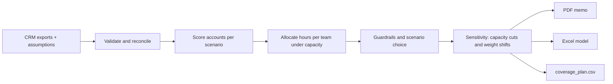

# GTM Allocation Engine

**Capacity-constrained go-to-market planning for RevOps, Sales and Finance leaders.**
Turns CRM exports into an auditable quarterly coverage plan, an executive memo (PDF), an Excel model, charts, and an importable `coverage_plan.csv`.

> All bundled data is **fictional**. Offline-first: no API keys, no paid services, no data leaves your machine.

## The decision it supports

> *We have limited selling capacity. Which accounts and segments should we cover next quarter, at what intensity, what do we deliberately leave out, and what would change the answer?*

It is a **planning and decision tool**, not a predictive "AI" that guesses who will buy. There is no win-probability model: scores are explainable heuristics and every assumption is visible and editable.

## Run

```bash
python -m venv .venv
# macOS/Linux: source .venv/bin/activate    Windows: .venv\Scripts\activate
python -m pip install -r requirements.txt
python -m gtm_planner                                   # demo data -> output/
python -m unittest discover -s tests -v
```

Outputs in `output/`: `gtm_investment_memo.pdf`, `gtm_planning_model.xlsx`, `coverage_plan.csv`, `charts/*.png`, `run_summary.json`.

### What-if and change tracking

```bash
python -m gtm_planner --out output/base
python -m gtm_planner --out output/shock --capacity-shock "NA Enterprise=-20" --baseline output/base/coverage_plan.csv
```
`plan_changes.csv` lists every account whose coverage changed and why; the memo summarizes who lost coverage.

## Input contract (CSV exports, no CRM integration required)

| File | Required columns | Typical source |
|---|---|---|
| `accounts.csv` | `account_id, account_name, region, segment, relationship (prospect/customer), owner_team, est_acv, currency, icp_fit (1-5), engagement (0-5), strategic (Y/N)` | CRM account export |
| `opportunities.csv` | `opp_id, account_id, stage, amount, currency, close_date (ISO), status (open/won/lost)` | CRM opportunity export |
| `capacity.csv` | `team, region, reps, hours_per_rep` | Sales leadership / RevOps |
| `assumptions.json` | FX, hours per coverage tier, value capture factors, thresholds, guardrails, scenarios | Decided jointly by Sales, Marketing, Finance |

`icp_fit` and `engagement` may be blank (imputed with the median and flagged). Bring your own export by mapping columns to this contract.

## How it works



1. **Data quality first.** Duplicates, orphan or stale opportunities, unknown currencies, missing fields and teams without capacity are detected; each rule logs an action (exclude, impute, flag). A data-confidence label is reported.
2. **Value at stake** = max(estimated ACV, valid open pipeline) in USD (avoids double counting).
3. **Priority score (0-100)** = weighted value percentile, ICP fit, engagement, strategic flag, optional relationship bonus. Weights live in `assumptions.json`.
4. **Allocation per team:** in-flight late-stage deals are ring-fenced; then high-touch by score; then light-touch with remaining hours.
5. **Scenarios** (Balanced, Enterprise Focus, Install-Base Expansion, New-Logo Acquisition) are compared on a common yardstick. The recommendation is the highest value-in-scope scenario that satisfies all leadership guardrails.
6. **Sensitivity:** one team's capacity is cut at a time; scenario weights are shifted +/-10 points to find marginal accounts.

## Reading the Excel model

Inputs are blue. Hours, capacity and value-in-scope are live formulas; the Executive Summary reconciles them against the Python engine. Excel/LibreOffice must recalculate before formula cells show values in some previewers. Editing assumptions in Excel recalculates hours and value for the current tier assignments; to **re-allocate**, edit `assumptions.json` and re-run.

## Honest limits

- **Value-in-scope is a planning index** (value at stake x capture factor), not a revenue forecast or ROI promise.
- No historical win rates are used. Hours per tier and capture factors are **assumptions to calibrate** with the last 4+ quarters of real data.
- Guardrails and thresholds in the demo are illustrative; leadership sets the real ones.
- Final coverage decisions stay with human leaders.

## Roadmap
Calibration module using historical outcomes, CRM import adapters (Salesforce/HubSpot exports), multi-currency FX per period, territory-level optimization, backtesting of past quarters.
